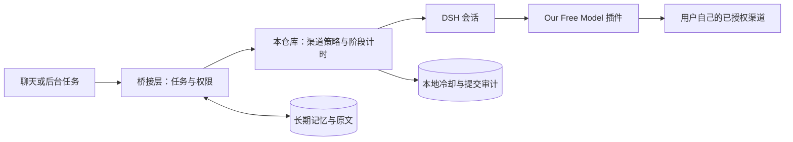

# 白饭鱼 · OFM 接入核心

让一个持续运行的聊天 Agent 使用 OFM 账号渠道：按任务选模型档位，按渠道记录额度冷却，在故障后决定能否安全继续。

这是从白饭鱼的实际集成中整理出的 **Node.js 核心模块与接入示例**。你可以直接运行离线演示、阅读和复用路由逻辑；连接真实模型需要已有 DSH、OFM 插件和使用者自己的渠道授权。

**Our Free Model 是 [Ebony-Vinyl/dsh-our-free-model](https://github.com/Ebony-Vinyl/dsh-our-free-model) 的项目。** 本仓库分享白饭鱼在其上的接入与治理实现，保留 [qq-bridge](https://github.com/Derpyu520/qq-bridge) 的来源与许可。这里不附带账号、额度或模型服务。

## 先运行看看

需要 Node.js 22.19+，建议 Node.js 24。无第三方依赖，不需要 `npm install`。

```sh
git clone https://github.com/tasuma-qwq/baifanyu-ofm-bridge.git
cd baifanyu-ofm-bridge
npm test
npm run demo
```

演示完全离线，使用固定时间和虚构事件，不读取本机登录态，也不发送 QQ 消息。它依次展示日常最低档、反思高档、日额度冷却、主备选择和未知行动不重试。临时演示文件会在结束时清理。

## 实现了什么

| 问题 | 实现 |
| --- | --- |
| 模型可选但账号渠道不可用 | 用当前 DSH 模型目录过滤候选，再跳过冷却渠道 |
| 一个渠道没额度，让整个 bot 停摆 | 按 `provider/model` 持久化冷却；其他渠道仍可被选择 |
| 不同渠道的思考档位名称不同 | 从模型目录读取词表，将 `lowest`、`high` 等偏好映射为合法档位 |
| 旧免费活动过期后继续选中 | 接入示例要求 CN 截止时间明确且未到期；示例配置初始关闭 |
| 长工具执行被当成模型卡死 | 工具执行暂停模型阶段计时，全部返回后恢复；工具自身另设期限 |
| 上游卡死时可能已发送过消息 | 最多两次尝试，取消未确认、工具已调用或行动结果未知时不自动重放 |
| “发起过请求”被当作“成功回复” | 本地审计区分 pending、completed、failed、unknown |

`completed` 只表示宿主调用方确认该逻辑提交完成，不代表 QQ 消息已送达，也不是上游账单凭证。

## 数据怎么走



OFM 负责模型接入及上游协议；本仓库负责调用前选路、冷却与宿主侧的安全约束。长期记忆由白饭鱼自己的存储层维护，不绑定某个模型渠道。

## 如何接入自己的项目

1. 按 [OFM 上游说明](https://github.com/Ebony-Vinyl/dsh-our-free-model) 安装插件，在你自己的 DSH 中完成合法授权。
2. 复制 `config.example.json` 为 `config.local.json`。核对当前模型目录、账号权益与活动期限，再设置 `enabled: true`。
3. CN 截止时间的示例值为已过期时间。只有核对到新的有效权益时才修改；渠道名称或模型 ID 变化时也要更新配置。
4. 参考 [宿主接入说明](docs/integration.md)，先等待模型选择确认，再提交任务。把真实事件流接给阶段计时器，把取消和行动回执接给安全重试判断。

`selectSessionRoute()` 只选择模型，不发起推理、不登录账号、不发送消息。完整 QQ 机器人、宿主安装器、账号渠道包和记忆系统不在这次发布范围中。

## 目录

```text
src/model-lanes.js       生产实现提取：允许链、档位、错误分类、冷却、有限尝试
src/turn-stall-guard.js  生产实现提取：模型阶段静默与活跃预算
src/inference-audit.js   生产实现提取：提交元数据审计
src/session-route.js     本次整理的宿主选模适配与保守重放判断
examples/               不联网的可运行示例
test/                   核心回归与公开适配契约测试
docs/architecture.md    设计细节与边界
docs/integration.md     真实宿主需要提供的接线
docs/video-script.md    抖音讲解稿、分镜和发布文案
```

## 费用、隐私与验证范围

- 账号渠道也可能消耗 Credits 或付费余额；本项目无法证明每次请求免费。已知额度耗尽、活动到期可以阻止相应选路，未报告余额或 usage 时保留未知。
- 一个逻辑回合可能包含多次模型步骤或上游请求。提交审计、token 统计和真实扣款分别核对，不把 API 等价估值写成账单。
- 推理内容仍会发送到你选择的上游。本仓库不携带凭据，不负责导入登录态。冷却文件里的错误原因与审计里的来源 ID 也可能敏感，分享前需处理。
- 本仓库的测试和演示均离线，只能验证策略与事件处理。本地实际部署曾进行独立供模及用户来信回复验证；这不构成任何其他账号或未来时刻的可用性承诺，也不证明长期稳定。
- 这次发布只整理独立副本，没有替换正在运行的白饭鱼。

记忆系统的下期内容预告见 [记忆系统说明](docs/memory-preview.md)。

## 来源与许可

MIT。保留本仓库 [LICENSE](LICENSE)、[NOTICE](NOTICE.md) 和 [qq-bridge 原许可](third_party/qq-bridge-LICENSE)。源码快照与改动范围见 [provenance.json](docs/provenance.json)。OFM 与 DSH 的代码及渠道包没有打包进本仓库，使用时遵循各自的许可和渠道规则。
